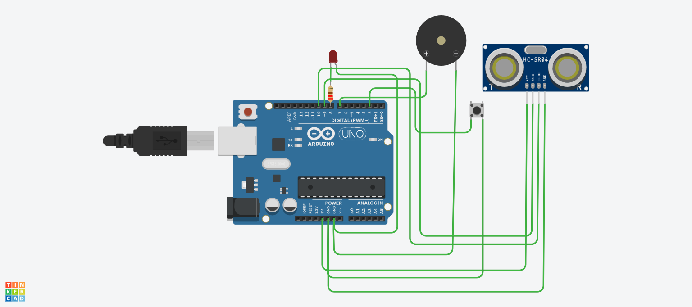

# Smart Water Tank Monitoring System using Ultrasonic Sensor, Push Button, LED and Piezo Buzzer

## Description

This project demonstrates a smart water tank monitoring system using two sensors and two actuators with an Arduino Uno in Tinkercad. An Ultrasonic Sensor measures the distance to the water surface to estimate the water level, while a Push Button acts as a manual alert trigger. An LED and a Piezo Buzzer provide visual and audible alerts whenever the water level becomes low or the emergency button is pressed.

The system continuously monitors the tank and reports the measured distance, water level, button state, LED state, buzzer state, and overall alert status through the Serial Monitor.

## Components Required

| Component | Quantity | Purpose |
| --- | --- | --- |
| Arduino Uno R3 | 1 | Controls the sensors and actuators |
| Ultrasonic Sensor (HC-SR04) | 1 | Measures the distance to the water surface |
| Push Button | 1 | Manual emergency alert trigger |
| Red LED | 1 | Visual alert indicator |
| 220 Ω Resistor | 1 | Limits the current through the LED |
| Piezo Buzzer | 1 | Audible alert indicator |
| Jumper Wires | As required | Circuit connections |

## Circuit Diagram



*Tinkercad simulation of the smart water tank monitoring system.*

## Connections

### Ultrasonic Sensor

| HC-SR04 Pin | Arduino Uno Pin |
| --- | --- |
| VCC | 5V |
| GND | GND |
| Trig | Digital Pin 9 |
| Echo | Digital Pin 10 |

### Push Button

| Push Button Terminal | Arduino Uno Pin |
| --- | --- |
| One Terminal | Digital Pin 2 |
| Other Terminal | GND |

> The push button uses the Arduino's internal pull-up resistor (`INPUT_PULLUP`). Therefore, the pin reads `HIGH` when the button is released and `LOW` when it is pressed.

### LED

| LED Pin | Connection |
| --- | --- |
| Anode (+) | Digital Pin 8 |
| Cathode (-) | 220 Ω Resistor → GND |

### Piezo Buzzer

| Piezo Buzzer Pin | Arduino Uno Pin |
| --- | --- |
| Positive (+) | Digital Pin 7 |
| Negative (-) | GND |

## Working

The Ultrasonic Sensor continuously measures the distance between the sensor and the water surface. A larger measured distance indicates a lower water level inside the tank. The Push Button can also be used to manually trigger the alert system.

- If the measured distance is greater than **15 cm**, the system detects a **low water level**.
- If the emergency button is pressed, the alert is also activated.
- When either condition is true, the **LED turns ON** and the **Piezo Buzzer sounds**.
- Otherwise, both the LED and Buzzer remain **OFF**, indicating that the water level is normal.

| Condition | Water Level | LED | Buzzer | Alert |
| --- | --- | --- | --- | --- |
| Distance > 15 cm | LOW | ON | ON | LOW WATER LEVEL |
| Button pressed | As measured | ON | ON | Alert active |
| Distance ≤ 15 cm and button released | NORMAL | OFF | OFF | Water Level Normal |

The Serial Monitor displays the measured distance, water level status, button status, LED status, buzzer status, and alert status.

## Output

**Low water level (distance greater than 15 cm):**

```text
Water Level Distance: 22 cm
Manual Button: Released
Water Level: LOW
LED: ON
Buzzer: ON
Alert: LOW WATER LEVEL
---------------------------
```

**Normal water level (distance less than or equal to 15 cm):**

```text
Water Level Distance: 8 cm
Manual Button: Released
Water Level: NORMAL
LED: OFF
Buzzer: OFF
Alert: Water Level Normal
---------------------------
```

## Applications

- Smart Water Tank Monitoring
- Water Level Detection Systems
- Home Water Storage Automation
- Industrial Tank Monitoring
- Smart Agriculture
- IoT-Based Water Management Systems

## Files

- `smart_water_tank_monitoring_system.ino` – Arduino source code
- `circuit.png` – Tinkercad circuit screenshot
- `bom.csv` – Bill of materials
- `Smart-Water-Tank-Mo.pdf` – Tinkercad schematic
